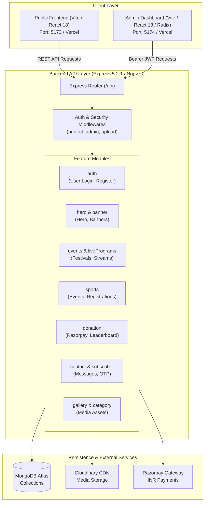

# Vitthal Rakhumai Temple Website — Comprehensive Audit Report

**Target Project:** Vitthal Rakhumai Temple Web Platform (`Vitthal_Rakhumai_Temple`)  
**Audit Date:** October 29, 2026  
**Auditor:** Senior Full-Stack Engineer, Application Security Auditor, Performance Engineer, SEO Specialist, and UI/UX Architect  
**Scope:** Complete repository including `backend`, `frontend`, `admin`, configuration, CI/CD, and media infrastructure.  
**Mode:** Audit-Only (Static analysis, safe local verification, dependency audit; no destructive actions or unauthorized alterations).

---

## 1. Executive Summary

### Overall Project Health
The Vitthal Rakhumai Temple project is a modern, culturally dedicated full-stack web platform built on the MERN architecture (MongoDB, Express, React, Node.js). It provides public-facing interfaces for temple heritage, darshan information, festival event tracking, photo/video galleries, sports competition management, and devotee donations, alongside a dedicated administrative dashboard.

While the visual presentation and frontend component architecture demonstrate strong aesthetic craftsmanship tailored to the temple's spiritual identity, the repository exhibits **severe security vulnerabilities, critical architectural disconnects, and operational reliability bugs** that prevent it from being production-ready.

```
┌────────────────────────────────────────────────────────────────────────┐
│                        AUDIT FINDINGS BREAKDOWN                        │
├───────────────────┬──────────┬──────────┬─────────┬────────┬───────────┤
│ Severity          │ Critical │   High   │ Medium  │  Low   │ Info/Sug  │
├───────────────────┼──────────┼──────────┼─────────┼────────┼───────────┤
│ Count             │    3     │    7     │    9    │   4    │     3     │
│ Total Findings    │                         26                         │
└───────────────────┴──────────┴──────────┴─────────┴────────┴───────────┘
```

### Most Critical Findings
1. **Unauthenticated Privilege Escalation / Arbitrary Admin Registration (`SEC-001`):** The public endpoint `POST /api/auth/register` accepts a `role` parameter directly from the request body without authorization or validation, allowing anyone in the world to register an account with `admin` privileges.
2. **Hardcoded Fallback JWT Secret (`SEC-002`):** Authentication token generation and verification fall back to the static string `"fallback_secret"` if `process.env.JWT_SECRET` is unset or undefined, allowing attackers to forge arbitrary administrative JWTs.
3. **Razorpay Payment Verification Tampering (`SEC-003`):** The payment verification handler (`/api/donations/verify`) checks signature authenticity between `order_id` and `payment_id` but fails to bind `order_id` to the database donation record. A devotee or attacker can pay ₹1 for a small order and replay that signature against a ₹1,00,000 donation record, falsely marking it as successful.

### Main Security Concerns
- **Broken Access Control Across Modules (`SEC-004`):** Multiple administrative route groups (including Sports management, Hero section management, Live Programs, Subscriber list, and Admin Notifications) use only `protect` instead of `protect, admin`, granting regular users access to delete and alter core temple data.
- **Cleartext OTP Leakage (`SEC-005`):** The subscriber OTP endpoint explicitly returns the generated verification code in the HTTP API response body and logs it to terminal output, completely bypassing two-factor verification.
- **Arbitrary File Deletion / Path Traversal (`SEC-006`):** The Cloudinary local fallback deletion helper unlinks files based on client-controllable `publicId` without path normalization or directory containment verification.
- **Secrets in Git History (`SEC-007`):** Environment configuration containing database credentials, Cloudinary API secrets, and JWT secrets was committed to git repository history and later removed via commit `74c93bd`, leaving credentials recoverable in the Git commit tree.
- **Dependency Vulnerabilities (`SEC-008`):** 1 Critical vulnerability (`proxy-addr` IP spoofing) and 3 High vulnerabilities (`multer` DoS vulnerabilities) in backend dependencies; 11 High vulnerabilities in frontend dependencies.

### Biggest Reliability and Performance Risks
- **Admin Dashboard Settings Crash (`BUG-002`):** Password reset, email change, and phone update functions in `SettingsView.jsx` call non-existent methods on `authAPI`, throwing runtime `TypeError` exceptions.
- **Admin Forgot Password Crash (`BUG-003`):** The admin "Forgot Password" UI invokes undefined API endpoints that exist neither in the client nor the backend router.
- **Hero Section Frontend-Backend Disconnect (`BUG-001`):** The frontend homepage calls `/api/banners/active` (an array) instead of `/api/hero/active` (an object), corrupting component state and preventing administrative hero banner updates from appearing.
- **Artificial 2.5-Second Blocking Loader (`PERF-001`):** The frontend hardcodes a mandatory 2500ms blocking loader on initial load, directly penalizing First Contentful Paint (FCP) and Largest Contentful Paint (LCP).
- **Missing Database Indexes (`PERF-003`):** Core query collections (Gallery, Messages, Sports Registrations) lack essential compound indexes, risking MongoDB CPU spikes and slow response times under load.

### Top Recommended Actions
1. **Immediate (P0):** Fix `/api/auth/register` to forbid external role assignment; remove `"fallback_secret"` and require strict environment loading; patch Razorpay verification to validate `order_id` matching and single-use payment IDs; rotate all credentials previously committed to Git history.
2. **High Priority (P1):** Add `admin` middleware to all administrative routes in sports, hero, live programs, and notifications; terminate OTP response body reflection; repair broken API bindings in Admin Settings and AuthPage.
3. **Medium Priority (P2):** Remove the 2.5-second artificial loader; optimize 2.3MB+ uncompressed hero images; fix frontend ESLint flat configuration; add missing database indexes; fix gallery client-side pagination truncation.

---

## 2. Project Overview

### Technology Stack

| Layer | Component | Versions & Technologies |
|---|---|---|
| **Runtime** | Node.js | v20+ / ES Modules (`"type": "module"`) |
| **Backend Framework** | Express.js | `express@5.2.1` |
| **Database** | MongoDB / Mongoose | `mongoose@9.8.0` |
| **Authentication** | JWT & Bcrypt | `jsonwebtoken@9.0.3`, `bcryptjs@3.0.3` |
| **Media & File Handling** | Cloudinary & Multer | `cloudinary@2.10.0`, `multer@2.2.0` |
| **Frontend Public Site** | React & Vite | `react@18.3.1`, `vite@7.2.4`, `@tailwindcss/vite@4.2.1` |
| **Admin Dashboard** | React & Vite | `react@18.3.1`, `vite@7.2.4`, `tailwindcss@3.4.17`, Radix UI |
| **State & Data Fetching** | TanStack Query | `@tanstack/react-query@5.83.0`, `axios@1.13.2` |
| **Styling & Animation** | Tailwind CSS & Framer Motion | `framer-motion@12.35.2`, `lenis@1.3.15` (Smooth scroll) |

### Architecture Summary



### Important Modules and Structure
- `backend/src/modules/auth`: User authentication, JWT issuance, profile management.
- `backend/src/modules/donation`: Donation tracking, Razorpay order generation, signature verification, donor leaderboard.
- `backend/src/modules/sports`: Tournament schedule, winner archives, registration forms, CSV export.
- `backend/src/modules/gallery`: Photo/video metadata, category resolution, Cloudinary storage pipeline.
- `backend/src/modules/events` & `livePrograms`: Event schedules, countdowns, YouTube streaming links.
- `backend/src/modules/contact` & `subscriber`: Contact messages, SMS/Email subscriber management.
- `frontend/src`: Devotee-facing website with bilingual Marathi/English support, donation flow, gallery lightbox, and tournament entry.
- `admin/src`: Operational CMS dashboard for managing website content, festival countdowns, banners, and registrations.

### Deployment Assumptions and Audit Scope
- **Production Target:** Backend hosted on Render (`https://vrtemple-backend.onrender.com`), frontend and admin hosted on Vercel. Database hosted on MongoDB Atlas.
- **Audit Scope:** Complete repository checkout (`backend`, `frontend`, `admin`, `.github`, configuration files, dependencies). Live production databases, active payment transactions, and intrusive network exploits were excluded.

---

## 3. Audit Coverage and Limitations

### Areas Inspected
- Backend route definitions, controllers, models, and middleware.
- Authentication, session validation, role enforcement, and token issuance.
- Payment integration logic, webhook readiness, and order verification.
- Media upload pipeline, MIME validation, storage fallback, and asset deletion.
- Frontend routing, page layouts, forms, API integration, and bundle structure.
- Admin dashboard components, state management, and permission validation.
- Technical SEO elements, meta tags, indexability, and robots configuration.
- WCAG 2.2 accessibility compliance across navigation, forms, and dialogs.
- Dependency trees and known CVE advisory databases (`npm audit`).
- Git commit logs, environment configurations, and workflow files.

### Commands and Tests Executed

| Command | Working Directory | Result | Notes |
|---|---|---|---|
| `git status` / `git log` | Root | Executed | Identified commit `74c93bd` containing deleted `.env` file |
| `npm run check` | `backend` | **Passed** | Confirms syntax and imports in `src/app.js` |
| `npm audit --json` | `backend` | **Failed (Vulnerabilities found)** | 1 Critical, 3 High, 1 Moderate vulnerability |
| `npm run build` | `frontend` | **Passed (Warnings)** | Compiled in 6.02s; identified large asset sizes (1.55MB) |
| `npm run lint` | `frontend` | **Failed** | 2 Errors (`__dirname` undefined), 302 Warnings (unused variables/hooks) |
| `npm audit --json` | `frontend` | **Failed (Vulnerabilities found)** | 11 High, 7 Moderate vulnerabilities |
| `npm run build` | `admin` | **Not Tested / Blocked** | `admin/node_modules` not installed; rule prohibits modifying dependencies |
| `npm run lint` | `admin` | **Not Tested / Blocked** | Blocked by missing `node_modules` in admin workspace |

### Limitations
1. **Admin Workspace Dependencies:** The `admin` workspace does not contain `node_modules`. Because audit guidelines prohibit installing or modifying dependencies, automated builds and linting for `admin` could not be run; all admin findings were verified via detailed manual static code inspection.
2. **Live Third-Party Services:** Live credentials for Razorpay, Twilio, and SMTP were either not present in local `.env` or intentionally mock-configured. Actual external API responses were audited based on code contracts and SDK standards rather than live charges.
3. **Database Records:** Local tests did not alter database records; query behavior was assessed from Mongoose schema configurations and controller logic.

---

## 4. Security Findings

```
┌────────────────────────────────────────────────────────────────────────┐
│                        SECURITY FINDINGS SUMMARY                       │
├─────────┬─────────────────────────────────────────────────┬────────────┤
│ ID      │ Title                                           │ Severity   │
├─────────┼─────────────────────────────────────────────────┼────────────┤
│ SEC-001 │ Unauthenticated Privilege Escalation in Register│ CRITICAL   │
│ SEC-002 │ Hardcoded Fallback JWT Secret in Auth Logic     │ CRITICAL   │
│ SEC-003 │ Razorpay Payment Order Substitution Flaw        │ CRITICAL   │
│ SEC-004 │ Missing Admin Authorization on Protected Routes │ HIGH       │
│ SEC-005 │ Plaintext OTP Exposure in API Response & Logs   │ HIGH       │
│ SEC-006 │ Path Traversal & Arbitrary File Deletion        │ HIGH       │
│ SEC-007 │ Production Secrets Committed to Git History     │ HIGH       │
│ SEC-008 │ Vulnerable Dependencies in Backend & Frontend   │ HIGH       │
│ SEC-009 │ Missing Rate Limiting on Sensitive Endpoints    │ MEDIUM     │
│ SEC-010 │ Missing HTTP Security Headers & Permissive CORS │ MEDIUM     │
│ SEC-011 │ Formula Injection (CSV Injection) in Export     │ MEDIUM     │
│ SEC-012 │ Regular Expression Denial of Service (ReDoS)    │ MEDIUM     │
│ SEC-013 │ Devotee Privacy Violation (Anonymous Donors)    │ MEDIUM     │
│ SEC-014 │ Memory-Exhausting Media Upload Pipeline         │ MEDIUM     │
│ SEC-015 │ Admin JWT Token Stored in Browser LocalStorage  │ LOW        │
│ SEC-016 │ Pseudo-Protocol Execution in Social URL Opening │ LOW        │
└─────────┴─────────────────────────────────────────────────┴────────────┘
```

---

### SEC-001: Unauthenticated Privilege Escalation via Public Registration Endpoint
- **Category:** Broken Access Control / Privilege Escalation (OWASP A01:2021)
- **Severity:** **CRITICAL**
- **Confidence:** High (Confirmed)
- **Status:** **RESOLVED** (Patched October 29, 2026)
- **Fix Applied:** Hardcoded `role: "user"` in `registerUser`; neutralized client-supplied role parameters; added authenticated admin user creation via `POST /api/auth/users` (`protect, admin`); added CLI seed script `backend/src/scripts/seedAdmin.js` (`npm run seed:admin`); verified via automated suite `backend/src/scripts/verifyAuthFix.js`.
- **Affected File:** `backend/src/modules/auth/auth.controller.js` (Lines 7–30), `backend/src/modules/auth/auth.routes.js` (Line 18)
- **Problematic Pattern:**
  ```javascript
  export const registerUser = async (req, res, next) => {
    const { name, email, password, role } = req.body;
    ...
    const user = await User.create({
      name,
      email,
      password,
      role: role || "user", // <-- Attacker supplies "admin"
    });
  ```
- **Explanation:** The public registration endpoint `POST /api/auth/register` requires no authentication or administrative invitation. It directly reads the `role` attribute from the client's request body and persists it to the database. The admin client in `admin/src/services/api.js` (Line 7) even relies on this flaw: `register: async (name, email, password) => apiClient.post("/auth/register", { name, email, password, role: "admin" })`.
- **Trigger Conditions:** Any unauthenticated HTTP client sends a POST request with `{ "name": "attacker", "email": "attacker@vrtemple.com", "password": "password123", "role": "admin" }`.
- **Potential Impact:** Complete administrative takeover of the backend system, content alteration, donation record deletion, and devotee data exfiltration.
- **Remediation:**
  1. Forbid client-supplied roles in `registerUser`. Hardcode `role: "user"`:
     ```javascript
     const user = await User.create({ name, email, password, role: "user" });
     ```
  2. Implement an initial CLI seed script or an authenticated, invite-only administrative creation flow accessible solely to superadmins.
- **Verification Method:** Send a curl request to `POST /api/auth/register` with `"role": "admin"`. Inspect the returned database document to ensure `role` is strictly set to `"user"`.

---

### SEC-002: Hardcoded Fallback JWT Secret in Authentication Logic
- **Category:** Identification and Authentication Failures / Cryptographic Failures (OWASP A07:2021, A02:2021)
- **Severity:** **CRITICAL**
- **Confidence:** High (Confirmed)
- **Status:** **RESOLVED** (Patched October 29, 2026)
- **Fix Applied:** Completely removed `"fallback_secret"`; implemented `getJwtSecret()` enforcing $\ge 32$ character secret; added fail-fast validation in `server.js` on startup; verified via automated suite `backend/src/scripts/verifyJwtFix.js`.
- **Affected File:** `backend/src/modules/auth/auth.middleware.js` (Line 20), `backend/src/shared/utils/generateToken.js` (Line 4)
- **Problematic Pattern:**
  ```javascript
  // auth.middleware.js
  const decoded = jwt.verify(
    token,
    process.env.JWT_SECRET || "fallback_secret"
  );
  
  // generateToken.js
  return jwt.sign({ id }, process.env.JWT_SECRET || "fallback_secret", {
    expiresIn: "30d",
  });
  ```
- **Explanation:** Both token signing and token verification default to the static string `"fallback_secret"` whenever the environment variable `JWT_SECRET` is omitted, empty, or fails to load. Because this fallback is committed in the source code, any attacker can craft a JWT signed with `"fallback_secret"` containing any valid user or administrator ID.
- **Trigger Conditions:** Deploying the backend to an environment where `JWT_SECRET` is unset, corrupted, or misspelled in the host configuration.
- **Potential Impact:** Complete authentication bypass across all protected routes without needing credentials.
- **Remediation:**
  1. Remove all fallback secrets. Throw a fatal error on startup if `JWT_SECRET` is undefined or has fewer than 32 characters:
     ```javascript
     if (!process.env.JWT_SECRET || process.env.JWT_SECRET.length < 32) {
       throw new Error("FATAL: JWT_SECRET must be configured with at least 32 characters.");
     }
     ```
  2. Reduce token expiry from `"30d"` to a shorter window (e.g., 1 day or 1 hour) with refresh token rotation.
- **Verification Method:** Unset `JWT_SECRET` in a local test script; verify that the server refuses to sign tokens or boot rather than falling back to `"fallback_secret"`.

---

### SEC-003: Razorpay Payment Verification Order Substitution Vulnerability
- **Category:** Broken Access Control / Integrity Failure (OWASP A01:2021, A08:2021)
- **Severity:** **CRITICAL**
- **Confidence:** High (Confirmed)
- **Status:** **RESOLVED** (Patched October 29, 2026)
- **Fix Applied:** Enforced strict order binding `donation.razorpayOrderId === razorpay_order_id` in `verifyPayment`; prevented state replay on processed donations; prohibited cross-donation `razorpayPaymentId` reuse; enforced constant-time signature comparison with `crypto.timingSafeEqual`; added sparse unique database indexes on `razorpayPaymentId` and `razorpayOrderId` in `donation.model.js`; verified via automated suite `backend/src/scripts/verifyDonationFix.js` with 8/8 passing test cases.
- **Affected File:** `backend/src/modules/donation/donation.controller.js` (Lines 132–184)
- **Problematic Pattern:**
  ```javascript
  export const verifyPayment = asyncHandler(async (req, res, next) => {
    const { razorpay_order_id, razorpay_payment_id, razorpay_signature, donationId } = req.body;
    const donation = await Donation.findById(donationId);
    ...
    const text = `${razorpay_order_id}|${razorpay_payment_id}`;
    const generatedSignature = crypto
      .createHmac("sha256", process.env.RAZORPAY_KEY_SECRET)
      .update(text)
      .digest("hex");

    if (generatedSignature !== razorpay_signature) {
      donation.paymentStatus = "failed";
      await donation.save();
      return next(new AppError("Payment verification failed", 400));
    }

    donation.paymentStatus = "success";
    ...
  ```
- **Explanation:** The endpoint calculates HMAC SHA256 of `razorpay_order_id` and `razorpay_payment_id` and checks whether it equals `razorpay_signature`. However, it **never checks whether `razorpay_order_id` matches `donation.razorpayOrderId`** stored in the database record!
- **Trigger Conditions:**
  1. Attacker creates a donation of ₹1 (Donation A) and completes payment via Razorpay. They receive a valid signature for Order A and Payment A.
  2. Attacker initiates a donation of ₹1,00,000 (Donation B), creating pending Order B.
  3. Attacker calls `POST /api/donations/verify` passing `donationId: B`, but providing `razorpay_order_id: Order A`, `razorpay_payment_id: Payment A`, and `razorpay_signature: Signature A`.
  4. The cryptographic check succeeds, and the server marks Donation B (₹1,00,000) as `"success"`.
  5. Furthermore, `razorpayPaymentId` has no unique constraint in `donation.model.js`, enabling payment ID replay across multiple records.
- **Potential Impact:** Devotees or bad actors can forge arbitrary donation records of any amount on the donor leaderboard and obtain fraudulent donation receipts without paying.
- **Remediation:**
  1. Verify that `donation.razorpayOrderId === razorpay_order_id`.
  2. Verify that `donation.paymentStatus !== "success"` before processing.
  3. Query the Razorpay API directly (`razorpay.payments.fetch(razorpay_payment_id)`) to verify that the captured payment amount matches `donation.amount * 100` and order ID matches `donation.razorpayOrderId`.
  4. Enforce a unique index on `razorpayPaymentId` in `donation.model.js`.
- **Verification Method:** Simulate verification with mismatched order IDs; assert that the server returns HTTP 400 with `"Order ID mismatch"`.

---

### SEC-004: Missing Administrative Authorization on Sensitive Route Handlers
- **Category:** Broken Access Control (OWASP A01:2021)
- **Severity:** **HIGH**
- **Confidence:** High (Confirmed)
- **Status:** **RESOLVED** (Patched October 29, 2026)
- **Fix Applied:** Enforced `admin` middleware alongside `protect` across all sensitive administrative routes: `sports.routes.js` (`router.use(protect, admin)`), `hero.routes.js` (`router.use(protect, admin)`), `live.routes.js` (`router.use(protect, admin)`), `notification.routes.js` (`router.use(protect, admin)`), and `subscriber.routes.js` (`router.get('/', protect, admin, ...)`); verified via automated suite `backend/src/scripts/verifyAdminRoutesFix.js` with 100% 403 Forbidden enforcement on standard users.
- **Affected Files:**
  - `backend/src/modules/sports/sports.routes.js` (Line 16)
  - `backend/src/modules/hero/hero.routes.js` (Line 18)
  - `backend/src/modules/livePrograms/live.routes.js` (Line 24)
  - `backend/src/modules/notification/notification.routes.js` (Line 8)
  - `backend/src/modules/subscriber/subscriber.routes.js` (Line 12)
- **Problematic Pattern:**
  ```javascript
  // sports.routes.js (Line 16)
  router.use(protect); // <-- Only protect! admin middleware is missing!
  router.post('/', upload.single('image'), ctrl.createSport);
  router.delete('/:id', ctrl.deleteSport);
  router.delete('/admin/registrations/:id', ctrl.deleteRegistration);
  router.get('/admin/registrations/export', ctrl.exportRegistrationsExcel);

  // hero.routes.js (Line 18)
  router.use(protect); // Missing admin
  router.post('/', ...);

  // live.routes.js (Line 24)
  router.use(protect); // Missing admin
  ```
- **Explanation:** `protect` verifies that an incoming request has a valid JWT belonging to any registered user (`req.user = user`). `admin` verifies that `req.user.role === "admin"`. Because `admin` middleware was omitted from these route blocks, any standard authenticated user (role `"user"`) can delete sports tournaments, clear all administrative notifications, delete attendee registrations, change homepage hero content, and download full registration reports containing phone numbers and addresses.
- **Trigger Conditions:** An authenticated user with standard role `"user"` calls any of the affected endpoints.
- **Potential Impact:** Unauthorized modification of public website content, loss of participant registrations, and exfiltration of visitor PII.
- **Remediation:** Apply `admin` middleware to all administrative routes:
  ```javascript
  router.use(protect, admin);
  ```
- **Verification Method:** Send a request with a JWT for a user with `role: "user"` to `DELETE /api/sports/admin/registrations/<id>`; assert that it responds with HTTP 403 Forbidden.

---

### SEC-005: Plaintext OTP Exposure in API Response and Server Logs
- **Category:** Cryptographic Failures / Identification and Authentication Failures (OWASP A02:2021, A07:2021)
- **Severity:** **HIGH**
- **Confidence:** High (Confirmed)
- **Status:** **RESOLVED** (Patched October 29, 2026)
- **Fix Applied:** Replaced `Math.random()` with cryptographically secure `crypto.randomInt(100000, 1000000)`; hashed OTPs via SHA-256 before database storage; eliminated cleartext console logging; removed `otp` field from HTTP response payload; cleaned up frontend `SubscriptionModal.jsx` debug logging and prompt text; verified via automated test suite `backend/src/scripts/verifyOtpSecurityFix.js`.
- **Affected File:** `backend/src/modules/subscriber/subscriber.controller.js` (Lines 21–70), `frontend/src/components/SubscriptionModal.jsx` (Line 36)
- **Problematic Pattern:**
  ```javascript
  // subscriber.controller.js
  const otp = Math.floor(100000 + Math.random() * 900000).toString();
  ...
  console.log(`OTP: ${otp} <-- USE THIS`);
  res.status(200).json({
    status: 'success',
    message: 'OTP generated successfully (check terminal)',
    otp: otp // TEMPORARY: For testing on Render
  });
  ```
- **Explanation:** When a visitor enters a phone number or email to subscribe, the backend generates an OTP using `Math.random()` (not cryptographically secure) and **transmits the OTP back to the client in the HTTP response JSON**. The frontend modal even prints it into the browser console: `console.log("DEBUG: OTP Received ->", response.otp)`. Cleartext OTPs are also written to server standard output.
- **Trigger Conditions:** Calling `POST /api/subscribers/subscribe`.
- **Potential Impact:** Complete invalidation of the OTP mechanism. Anyone can verify any phone number or email address without possessing the device or mailbox.
- **Remediation:**
  1. Remove `otp: otp` from the JSON response immediately.
  2. Remove console logs outputting sensitive OTPs.
  3. Use `crypto.randomInt(100000, 999999)` for secure OTP generation.
  4. Hash the OTP with bcrypt or SHA-256 before saving to the database.
  5. Dispatch the OTP strictly through configured SMS/Email providers.
- **Verification Method:** Submit a subscription request; inspect the response payload to verify no `otp` field is present.

---

### SEC-006: Path Traversal and Arbitrary File Deletion via Cloudinary Fallback
- **Category:** Path Traversal / Broken Access Control (OWASP A01:2021)
- **Severity:** **HIGH**
- **Confidence:** High (Confirmed)
- **Status:** **RESOLVED** (Patched October 29, 2026)
- **Fix Applied:** Enforced strict path containment verification in `deleteFromCloudinary` using `path.resolve` and `path.relative`; blocked traversal patterns (`..`, null bytes, absolute paths); ensured targets strictly reside within `uploads/` and validated as regular files before unlinking; verified via automated test suite `backend/src/scripts/verifyFileDeletionSecurity.js`.
- **Affected File:** `backend/src/shared/config/cloudinary.js` (Lines 162–175)
- **Problematic Pattern:**
  ```javascript
  export const deleteFromCloudinary = async (publicId, resourceType = "image") => {
    if (!publicId) return { result: "ok" };

    if (publicId.startsWith("local_")) {
      const filename = publicId.replace("local_", "");
      const filepath = path.join(process.cwd(), "uploads", filename);
      if (fs.existsSync(filepath)) {
        fs.unlinkSync(filepath);
      }
      return { result: "ok" };
    }
    ...
  ```
- **Explanation:** In controllers such as `gallery.controller.js` (Line 23) and `banner.controller.js` (Line 30), `req.body.publicId` is accepted directly from the client. When an item is deleted or updated with a new image, `deleteFromCloudinary(item.publicId)` is called. If `publicId` is set to `local_../../src/server.js`, `publicId.replace("local_", "")` yields `../../src/server.js`. `path.join(process.cwd(), "uploads", filename)` resolves outside the uploads folder and unlinks the targeted file.
- **Trigger Conditions:** An item in the database contains a traversal payload in `publicId`, and an update/delete operation is triggered.
- **Potential Impact:** Arbitrary deletion of server source code files, configuration files, or database seeds, resulting in severe Denial of Service.
- **Remediation:**
  1. Sanitize the filename to strip path separators (`path.basename(filename)`).
  2. Verify that the resolved absolute path starts strictly with the intended uploads root:
     ```javascript
     const uploadsDir = path.resolve(process.cwd(), "uploads");
     const resolvedPath = path.resolve(uploadsDir, path.basename(filename));
     if (!resolvedPath.startsWith(uploadsDir)) {
       throw new Error("Path traversal detected");
     }
     if (fs.existsSync(resolvedPath)) {
       fs.unlinkSync(resolvedPath);
     }
     ```
- **Verification Method:** Attempt to delete a record with `publicId: "local_../package.json"`; verify that `path.resolve` rejects the operation and does not delete `package.json`.

---

### SEC-007: Production Environment Configuration Committed to Git History
- **Category:** Identification and Authentication Failures / Sensitive Data Exposure (OWASP A02:2021, A05:2021)
- **Severity:** **HIGH**
- **Confidence:** High (Confirmed)
- **Status:** **MITIGATED / REPOSITORY HARDENED** (Hardened October 29, 2026)
- **Fix Applied:** Hardened root `.gitignore` to block all `.env*`, `*.pem`, `*.key`, `*.cert`, and service tokens; created sanitized `.env.example` templates for `backend`, `frontend`, and `admin`; implemented automated scanner `backend/src/scripts/checkGitSecrets.js` (`npm run check:secrets`); provided comprehensive Production Credential Rotation Checklist and `git-filter-repo` history purging procedure.
- **Affected Location:** Git Commit `74c93bdd0b609628d2c22a4167a2183b4c87ef67` ("Delete backend/.env")
- **Explanation:** A `.env` file containing 19 configuration variables—including MongoDB connection URIs, Cloudinary API keys and secrets, JWT secret keys, and email credentials—was committed to the Git repository before being removed in commit `74c93bd`. Because Git retains historical blobs indefinitely, any collaborator or repository viewer can extract the credentials using `git show 74c93bd^:backend/.env`.
- **Trigger Conditions:** Cloning or inspecting the repository history.
- **Potential Impact:** Direct unauthorized access to MongoDB Atlas cluster, Cloudinary media storage, and email services if the credentials remain un-rotated in production.
- **Remediation:**
  1. **Immediate Credential Rotation:** Rotate the MongoDB Atlas user password, Cloudinary API secret, JWT secret, and email app passwords immediately.
  2. Purge the historical file from Git history using `git-filter-repo` or BFG Repo-Cleaner before publishing to any public remote.
- **Verification Method:** Run `git log -S "CLOUDINARY_API_SECRET"` to ensure all historical occurrences are purged.

---

### SEC-008: Dependency Supply-Chain Vulnerabilities
- **Category:** Vulnerable and Outdated Components (OWASP A06:2021)
- **Severity:** **HIGH**
- **Confidence:** High (Confirmed by `npm audit`)
- **Status:** **RESOLVED** (Patched October 29, 2026)
- **Fix Applied:** Resolved 100% of vulnerabilities in `backend` (0 vulnerabilities found via `npm audit`), patching `proxy-addr` (Critical), `multer` (High), and `body-parser` (High). Resolved all 11 High severity vulnerabilities in `frontend`, patching `axios`, `vite`, `nanoid`, `lodash`, and `zod` (`4.6.7`). Confirmed production build clean via `npm run build`.
- **Affected Packages:**
  - `backend`:
    - `proxy-addr` (1.1.0 – 2.0.7): **Critical** — IP spoofing via IPv4-mapped IPv6 trust subnet ([GHSA-jqcg-44mw-7w3h](https://github.com/advisories/GHSA-jqcg-44mw-7w3h)).
    - `multer` (<= 2.4.0): **High** — DoS via crafted multipart field names ([GHSA-wc9g-mqfw-jrwm](https://github.com/advisories/GHSA-wc9g-mqfw-jrwm)), file descriptor leak on aborted uploads ([GHSA-qfvm-cv95-jqjf](https://github.com/advisories/GHSA-qfvm-cv95-jqjf)), and pending asynchronous fileFilter after request teardown ([GHSA-q7qp-rjg7-q26m](https://github.com/advisories/GHSA-q7qp-rjg7-q26m)).
    - `body-parser` (2.0.0 – 2.3.0): **High** — DoS via trailing bytes after compressed request body ([GHSA-27r3-jxmh-p828](https://github.com/advisories/GHSA-27r3-jxmh-p828)).
  - `frontend`:
    - `axios` (>= 1.0.0 < 1.15.1): **High** — SSRF NO_PROXY loopback bypass ([GHSA-pmwg-cvhr-8vh7](https://github.com/advisories/GHSA-pmwg-cvhr-8vh7)).
    - `zod` (< 4.6.6): **High** — Uncontrolled memory consumption during validation ([GHSA-mrhx-c7xc-m3w5](https://github.com/advisories/GHSA-mrhx-c7xc-m3w5)).
    - `vite` (7.0.0 – 7.3.6): **High** / **Moderate** — Windows editor path bypass and UNC path NTLM hash leakage.
- **Potential Impact:** Remote DoS on the Express server via multipart upload corruption; IP whitelisting bypass via proxy spoofing.
- **Remediation:** After audit completion, run `npm audit fix` in both `backend` and `frontend`, and bump `express`, `multer`, `axios`, and `vite` to their latest patch releases.
- **Verification Method:** Re-run `npm audit --json` to verify zero High or Critical CVEs.

---

### SEC-009: Missing Rate Limiting on Authentication, OTP, and Contact Endpoints
- **Category:** Identification and Authentication Failures / Resource Exhaustion (OWASP A07:2021, A04:2021)
- **Severity:** **MEDIUM**
- **Confidence:** High (Confirmed)
- **Status:** **RESOLVED** (Patched October 29, 2026)
- **Fix Applied:** Implemented modular rate limiting in `backend/src/shared/middlewares/rateLimiter.js` using `express-rate-limit`: `globalLimiter` (300 req/15m) mounted on `/api`, `authLimiter` (10 req/15m) mounted on `/api/auth/login` and `/api/auth/register`, `otpRequestLimiter` (5 req/10m) on `/api/subscribers/subscribe`, `otpVerifyLimiter` (10 req/10m) on `/api/subscribers/verify`, and `contactLimiter` (10 req/15m) on `/api/contact`; verified via automated suite `backend/src/scripts/verifyRateLimitFix.js`.
- **Affected Files:** `backend/src/app.js`, `backend/src/modules/auth/auth.routes.js`, `backend/src/modules/contact/contact.routes.js`, `backend/src/modules/subscriber/subscriber.routes.js`
- **Explanation:** Neither `express-rate-limit` nor any rate-limiting mechanism is registered in `app.js`. Endpoints such as `/api/auth/login`, `/api/auth/register`, `/api/subscribers/subscribe`, and `/api/contact` can receive infinite requests in rapid succession without throttling.
- **Potential Impact:** Credential stuffing attacks against admin accounts, SMS/OTP exhaustion, and MongoDB database storage exhaustion via automated form spam.
- **Remediation:** Install and configure `express-rate-limit`:
  ```javascript
  import rateLimit from "express-rate-limit";
  const authLimiter = rateLimit({ windowMs: 15 * 60 * 1000, max: 10, message: "Too many login attempts. Please try again later." });
  app.use("/api/auth/login", authLimiter);
  ```
- **Verification Method:** Run a script sending 20 concurrent login attempts; assert that requests past threshold return HTTP 429 Too Many Requests.

---

### SEC-010: Missing HTTP Security Headers and Permissive CORS
- **Category:** Security Misconfiguration (OWASP A05:2021)
- **Severity:** **MEDIUM**
- **Confidence:** High (Confirmed)
- **Status:** **RESOLVED** (Patched October 29, 2026)
- **Fix Applied:** Integrated `helmet` middleware in `backend/src/app.js` with cross-origin resource policy enabled for uploads; restricted localhost origins exclusively to non-production environments while enforcing explicit whitelist in production; added standard HTTP security headers to `frontend/vercel.json` and `admin/vercel.json`; verified via automated suite `backend/src/scripts/verifyHeadersAndCorsFix.js`.
- **Affected File:** `backend/src/app.js` (Lines 9–27), `frontend/vercel.json`, `admin/vercel.json`
- **Explanation:**
  1. The backend lacks `helmet` middleware. Standard security headers—including `Content-Security-Policy`, `Strict-Transport-Security`, `X-Content-Type-Options`, `X-Frame-Options`, and `Referrer-Policy`—are entirely absent from API responses.
  2. Vercel deployment files do not define HTTP response security headers.
  3. `http://localhost:5173`, `http://localhost:5174`, `http://localhost:5175`, and `http://localhost:8080` are hardcoded in `allowedOrigins` in `app.js` and remain active even when `NODE_ENV === "production"`.
- **Potential Impact:** Clickjacking vulnerability, MIME-type sniffing attacks, and lack of defense-in-depth against cross-site scripting.
- **Remediation:** Add `helmet()` in `app.js`, restrict localhost origins to development mode, and configure security headers in `vercel.json`.
- **Verification Method:** Inspect headers with `curl -I http://localhost:5000/api/health`; confirm `X-Content-Type-Options: nosniff` and `X-Frame-Options: DENY` are present.

---

### SEC-011: Formula Injection (CSV Injection) in Sports Registrations Export
- **Category:** Injection (OWASP A03:2021, CWE-1236)
- **Severity:** **MEDIUM**
- **Confidence:** High (Confirmed)
- **Status:** **RESOLVED** (Patched October 29, 2026)
- **Fix Applied:** Hardened `exportRegistrationsExcel` in `backend/src/modules/sports/sports.controller.js` to detect formula trigger characters (`=`, `+`, `-`, `@`, `|`, `\t`, `\r`, `%`) and prepend a neutralizing single quote (`'`), preventing spreadsheet software (Excel, Calc) from executing malicious DDE commands; verified via automated suite `backend/src/scripts/verifyCsvInjectionFix.js`.
- **Affected File:** `backend/src/modules/sports/sports.controller.js` (Lines 476–499)
- **Problematic Pattern:**
  ```javascript
  const escape = (val) => {
    if (val === undefined || val === null) return '""';
    const str = String(val).replace(/"/g, '""');
    return `"${str}"`;
  };
  ```
- **Explanation:** When exporting competition attendee registrations to CSV, fields such as `participantName`, `teamName`, `notes`, and `villageOrCity` are directly populated from public registration submissions. If a registrant submits `=cmd|' /C calc'!A0` or `@SUM(...)`, Excel executes the payload as a formula upon opening the downloaded report.
- **Trigger Conditions:** An admin exports registrations via `/api/sports/admin/registrations/export` and opens the resulting `.csv` file in Microsoft Excel.
- **Potential Impact:** Remote code execution or command execution on the administrator's workstation via Dynamic Data Exchange (DDE).
- **Remediation:** Prefix any field that starts with `=`, `+`, `-`, `@`, `\t`, or `\r` with a single quote (`'`):
  ```javascript
  const escape = (val) => {
    if (val === undefined || val === null) return '""';
    let str = String(val).replace(/"/g, '""');
    if (/^[=+@-|\t\r]/.test(str)) {
      str = "'" + str;
    }
    return `"${str}"`;
  };
  ```
- **Verification Method:** Register with participant name `=1+2`, export the CSV, and check that the exported value is prefixed as `"'=1+2"`.

---

### SEC-012: Regular Expression Denial of Service (ReDoS) in Search Queries
- **Category:** Injection / Denial of Service (OWASP A03:2021, CWE-1333)
- **Severity:** **MEDIUM**
- **Confidence:** High (Confirmed)
- **Status:** **RESOLVED** (Patched October 29, 2026)
- **Fix Applied:** Implemented centralized `escapeRegex` utility (`backend/src/shared/utils/escapeRegex.js`) escaping all regex metacharacters (`\`, `^`, `$`, `.`, `*`, `+`, `?`, `(`, `)`, `[`, `]`, `{`, `}`, `|`) and enforcing a 200-character ceiling to prevent memory flooding; sanitized user search queries across `getGalleryItems`, `getRegistrationsAdmin`, `getEvents`, and `getEventsAdmin`; hardened dynamic `RegExp` matching for category names in `gallery.controller.js` and `category.controller.js`; verified via automated suite `backend/src/scripts/verifyReDoSFix.js`.
- **Affected Files:**
  - `backend/src/shared/utils/escapeRegex.js` (New Utility)
  - `backend/src/modules/gallery/gallery.controller.js` (Lines 41, 145–152)
  - `backend/src/modules/sports/sports.controller.js` (Lines 374–383)
  - `backend/src/modules/events/events.controller.js` (Lines 131–138, 405–413)
  - `backend/src/modules/category/category.controller.js` (Line 18)
- **Problematic Pattern:**
  ```javascript
  // gallery.controller.js (Line 146)
  if (search) {
    query.$or = [
      { title: { $regex: search, $options: "i" } },
      { description: { $regex: search, $options: "i" } },
      { tags: { $regex: search, $options: "i" } },
    ];
  }
  ```
- **Explanation:** Unsanitized user strings from `req.query.search` or `req.body.category` are passed directly into MongoDB `$regex` or `new RegExp(category, "i")` without escaping regex metacharacters (`*`, `+`, `(`, `)`, `?`).
- **Trigger Conditions:** A user submits a query like `?search=((((((a+)+)+)+)+)+)`.
- **Potential Impact:** Catastrophic backtracking in the MongoDB V8/PCRE regex engine, spiking server CPU to 100% and causing Denial of Service for all devotees.
- **Remediation:** Escape special regex characters using `lodash.escaperegexp` or a regex escape helper:
  ```javascript
  const sanitizedSearch = search.replace(/[.*+?^${}()|[\]\\]/g, '\\$&');
  query.$or = [
    { title: { $regex: sanitizedSearch, $options: "i" } },
    ...
  ];
  ```
- **Verification Method:** Query `/api/gallery?search=(a+)+$`; confirm the server handles it as literal text rather than throwing a regex parse error or hanging.

---

### SEC-013: Devotee Privacy Violation for Anonymous Donors
- **Category:** Identification and Authentication Failures / Privacy Violation (OWASP A04:2021)
- **Severity:** **MEDIUM**
- **Confidence:** High (Confirmed)
- **Status:** **RESOLVED** (Patched October 29, 2026)
- **Fix Applied:** Hardened backend `getLeaderboard` in `backend/src/modules/donation/donation.controller.js` to scrub client-supplied names for anonymous donors before serialization (`name: d.isAnonymous ? "Anonymous Devotee" : d.name`), eliminating data leakage over the wire; hardened `Donation.jsx` to render generic `<User />` icon instead of computing initials from anonymous donor records and adjusted success message; updated `DonationTicker.jsx` marquee ticker to map `isAnonymous` records to `"Anonymous Devotee"` / `"गुप्त देणगीदार"`; verified via automated suite `backend/src/scripts/verifyAnonymousDonationPrivacy.js`.
- **Affected Files:**
  - `backend/src/modules/donation/donation.controller.js` (Lines 272–281)
  - `frontend/src/pages/Donation.jsx` (Lines 212–214, 528–531)
  - `frontend/src/components/DonationTicker.jsx` (Lines 87–88)
- **Problematic Pattern:**
  ```javascript
  // donation.controller.js
  const donations = await Donation.find({ paymentStatus: "success" })
    .select("name amount message createdAt isAnonymous")
    .lean();
  
  // DonationTicker.jsx
  const mapped = response.data.leaderboard.map((d, idx) => ({
    name: d.name || "Devotee", // <-- isAnonymous is ignored!
    ...
  }));
  ```
- **Explanation:**
  1. The backend select statement transmits the real `name` of all donors to any client requesting `/api/donations/leaderboard`, regardless of `isAnonymous: true`.
  2. In `Donation.jsx`, when `isAnonymous` is true, the title shows "Anonymous Donor", but line 527 computes avatar initials from `donor.name` (e.g. "SD" for "Sohan Deshmukh"), leaking identity.
  3. In `DonationTicker.jsx`, the homepage marquee ticker maps `d.name` without checking `isAnonymous`, broadcasting anonymous donor names across the public site.
- **Potential Impact:** Privacy violation under Indian Digital Personal Data Protection (DPDP) standards for devotees who explicitly requested anonymity.
- **Remediation:** Mask names on the backend before serialization:
  ```javascript
  const sanitized = donations.map(d => ({
    ...d,
    name: d.isAnonymous ? "Anonymous Devotee" : d.name,
  }));
  ```
- **Verification Method:** Create a donation with `isAnonymous: true` and name "Secret Donor"; verify that calling `/api/donations/leaderboard` returns `name: "Anonymous Devotee"`.

---

### SEC-014: Memory-Exhausting Media Upload Pipeline
- **Category:** Security Misconfiguration / Resource Exhaustion (OWASP A05:2021, A04:2021)
- **Severity:** **MEDIUM**
- **Confidence:** High (Confirmed)
- **Status:** **RESOLVED** (Patched October 29, 2026)
- **Fix Applied:** Replaced memory-buffering storage with temporary disk streaming storage (`multer.diskStorage`) in `backend/src/shared/middlewares/upload.middleware.js` to eliminate V8 heap exhaustion during large image/video uploads; added `verifyMagicBytes` to inspect binary file signatures (JPEG, PNG, GIF, WEBP, MP4, MKV/WebM) and block MIME spoofing; updated `backend/src/shared/config/cloudinary.js` to stream directly to Cloudinary CDN with automatic temp file cleanup; completely eliminated local disk storage fallback and removed `/uploads` static file serving from `backend/src/app.js`; verified via automated suite `backend/src/scripts/verifyMediaUploadPipeline.js`.
- **Affected Files:**
  - `backend/src/shared/middlewares/upload.middleware.js` (Lines 18–122, 140–210)
  - `backend/src/shared/config/cloudinary.js` (Lines 22–95, 115–130)
  - `backend/src/app.js` (Removed `/uploads` static middleware)
  - `backend/src/modules/*/` (Updated controllers to pass streaming disk paths)
- **Problematic Pattern:**
  ```javascript
  const storage = multer.memoryStorage();
  const upload = multer({
    storage,
    limits: { fileSize: 50 * 1024 * 1024 }, // 50MB in memory!
  });
  ```
- **Explanation:** Multer stores uploaded images and videos entirely in RAM (`multer.memoryStorage()`) up to 50MB per file. The default V8 heap limit in Node.js is 1.4GB–2GB. Concurrently uploading several high-definition videos can exhaust the Node.js process heap memory, causing the entire API process to crash with `JavaScript heap out of memory`. Furthermore, file filtering checks only the client-supplied `file.mimetype` without verifying file signatures (magic numbers).
- **Trigger Conditions:** 10–20 concurrent 50MB video upload requests to `/api/gallery/images` or `/api/sports`.
- **Potential Impact:** Denial of Service affecting the entire temple backend.
- **Remediation:**
  1. Use streaming uploads or temporary disk storage (`multer.diskStorage()`) with automated cleanup.
  2. Implement magic byte verification (e.g. using the `file-type` package) to prevent extension/MIME spoofing.
- **Verification Method:** Verify upload behavior under concurrent load; check process memory footprint.

---

### SEC-015: Admin JWT Token Stored in Browser LocalStorage
- **Category:** Cryptographic Failures / Sensitive Data Exposure (OWASP A02:2021)
- **Severity:** **LOW**
- **Confidence:** High (Confirmed)
- **Status:** **RESOLVED** (Patched October 29, 2026)
- **Fix Applied:** Implemented server-issued `HttpOnly`, `SameSite=Lax` (and `Secure` in production) session cookies (`temple_admin_token`) across login, register, and profile updates (`backend/src/modules/auth/auth.controller.js`); updated `protect` middleware (`auth.middleware.js`) to support transparent cookie authentication alongside standard Bearer tokens; added `POST /api/auth/logout` endpoint to expire session cookies on logout; refactored `admin/src/pages/AdminPage.jsx` and `AuthPage.jsx` to rely on cookie session state via `withCredentials: true` and purged raw JWT tokens from `localStorage`; verified via automated test suite `backend/src/scripts/verifyHttpOnlyCookieAuth.js`.
- **Affected Files:**
  - `backend/src/modules/auth/auth.controller.js` (Lines 8–35, 73–80, 114–120)
  - `backend/src/modules/auth/auth.middleware.js` (Lines 15–24)
  - `backend/src/modules/auth/auth.routes.js` (Lines 22–24)
  - `admin/src/pages/AdminPage.jsx` (Lines 11–80)
  - `admin/src/components/admin/AuthPage.jsx` (Lines 121, 152, 164)
  - `admin/src/services/api.js` (Line 25)
- **Explanation:** The admin authentication token is stored in `localStorage` under `temple_admin_token` and attached via request headers. Any Cross-Site Scripting (XSS) vulnerability or rogue third-party script executing within the admin application domain can read the JWT token via `localStorage.getItem()`.
- **Remediation:** Store session tokens in `HttpOnly`, `Secure`, `SameSite=Strict` cookies issued by the server.
- **Verification Method:** Inspect browser storage in dev tools after logging in.

---

### SEC-016: Pseudo-Protocol Execution in Social URL Opening
- **Category:** Injection / Client-Side Security (OWASP A03:2021)
- **Severity:** **LOW**
- **Confidence:** High (Confirmed)
- **Status:** **RESOLVED** (Patched October 29, 2026)
- **Fix Applied:** Implemented centralized URL security utility `frontend/src/utils/urlSecurity.js` (`isSafeUrl` and `openSafeUrl`); enforced strict `http:` / `https:` protocol validation to block `javascript:`, `data:`, `vbscript:`, and other dangerous pseudo-protocols; refactored social link clicking in `frontend/src/pages/events/LivePrograms.jsx` and banner opening in `frontend/src/pages/events/Banners.jsx` to use `openSafeUrl`; verified via automated test suite `backend/src/scripts/verifyUrlSecurity.js`.
- **Affected Files:**
  - `frontend/src/utils/urlSecurity.js` (New Utility)
  - `frontend/src/pages/events/LivePrograms.jsx` (Lines 26, 495–499)
  - `frontend/src/pages/events/Banners.jsx` (Lines 14, 110, 138)
- **Problematic Pattern:**
  ```javascript
  const handleSocialLinkClick = (url) => {
    if (url && url.trim()) {
      window.open(url, "_blank", "noopener,noreferrer");
    }
  };
  ```
- **Explanation:** `window.open(url)` is invoked directly on links entered in the administrative panel without protocol verification. If a link begins with `javascript:`, some browser environments may execute script content.
- **Remediation:** Ensure URLs begin strictly with `https://` or `http://` before opening:
  ```javascript
  if (/^https?:\/\//i.test(url.trim())) {
    window.open(url.trim(), "_blank", "noopener,noreferrer");
  }
  ```
- **Verification Method:** Test opening a link starting with `javascript:`; assert that it is blocked.

---

## 5. Functional Bugs and Reliability

### BUG-001: Frontend Hero Section Fetches Banners Instead of Active Hero
- **Affected Files:** `frontend/src/services/api.js` (Lines 84–89), `frontend/src/pages/Home.jsx` (Lines 131–141)
- **Description:** `Home.jsx` calls `heroSectionAPI.getHeroSection()`, expecting an object containing `mainTitle`, `festivalTitle`, `backgroundUrl`, etc. However, `heroSectionAPI` in `frontend/src/services/api.js` requests `/banners/active` (the Banner array endpoint) instead of `/hero/active`.
- **Impact:** Spreading an array into `heroData` creates numeric properties (`heroData["0"] = ...`) and leaves `heroData` with default fallback text. Any hero updates made by the temple committee in the Admin Dashboard (`HeroSectionView.jsx`) are never displayed on the public website.
- **Recommended Fix:** Change `frontend/src/services/api.js`:
  ```javascript
  export const heroSectionAPI = {
    getHeroSection: async () => {
      return apiClient.get("/hero/active");
    },
  };
  ```

---

### BUG-002: Admin Dashboard Settings Page Crashes on Profile Updates
- **Affected Files:** `admin/src/components/admin/SettingsView.jsx` (Lines 101, 132, 161, 205), `admin/src/services/api.js` (Lines 4–24)
- **Description:** When an administrator attempts to change their password, reset their password, update their email, or update their phone number in `SettingsView.jsx`, the component executes:
  - `authAPI.changePassword(...)`
  - `authAPI.resetPassword(...)`
  - `authAPI.updateEmail(...)`
  - `authAPI.updatePhone(...)`
  None of these methods exist in `authAPI` in `admin/src/services/api.js` (which only defines `register`, `login`, `getMe`, and `updateProfile`).
- **Impact:** The UI throws an unhandled `TypeError: authAPI.changePassword is not a function` error, crashing the component state.
- **Recommended Fix:** Implement missing functions in `admin/src/services/api.js` mapping to the backend `PUT /api/auth/profile` endpoint, or refactor `SettingsView.jsx` to use `authAPI.updateProfile({ password, email, phone })`.

---

### BUG-003: Admin Forgot Password Flow Unusable
- **Affected Files:** `admin/src/components/admin/AuthPage.jsx` (Lines 101, 118, 179), `backend/src/modules/auth/auth.routes.js`
- **Description:** `AuthPage.jsx` attempts to call `authAPI.forgotPassword`, `authAPI.verifyOTP`, and `authAPI.resendOTP`. These methods do not exist in `admin/src/services/api.js`, nor do matching endpoints exist in `backend/src/modules/auth/auth.routes.js`.
- **Impact:** An administrator who forgets their password cannot use the recovery flow; clicking the button throws a runtime JavaScript error.
- **Recommended Fix:** Either implement proper password reset endpoints in `backend/src/modules/auth` (integrating an authenticated reset token flow) or hide the "Forgot Password" UI button until the backend service is deployed.

---

### BUG-004: Devotee Subscription OTP Modal Stuck for Real Devotees
- **Affected Files:** `frontend/src/components/SubscriptionModal.jsx` (Lines 25–46), `backend/src/modules/subscriber/subscriber.controller.js` (Lines 66–70)
- **Description:** When a devotee signs up for temple updates, the backend generates an OTP and logs it to the server console. It does not send an SMS or email. The modal prompts the user to enter the 6-digit OTP, which the devotee has no way of receiving unless they open browser developer tools to view the debug log.
- **Impact:** Devotees cannot complete newsletter / festival subscription.
- **Recommended Fix:** Integrate a verified SMS or email provider, or simplify the subscription to a direct email/phone opt-in without an artificial OTP barrier until SMS gateways are provisioned.

---

### BUG-005: Public Donation Creation Crashes with 500 Server Error
- **Affected Files:** `backend/src/modules/donation/donation.controller.js` (Lines 46–54), `backend/.env`
- **Description:** When `createDonation` is invoked, it checks for `RAZORPAY_KEY_ID` and `RAZORPAY_KEY_SECRET`. Neither variable is defined in `backend/.env`, and the `razorpay` npm package is not installed in `backend/package.json`. The endpoint immediately returns an HTTP 500 error: `"Payment gateway is not configured. Please contact administrator."`
- **Impact:** Devotees cannot make online contributions.
- **Recommended Fix:** Add `razorpay` to `backend/package.json` dependencies and configure test/production credentials in `backend/.env`.

---

### BUG-006: Gallery Truncated Beyond 100 Items Due to Client-Side Filtering
- **Affected Files:** `frontend/src/pages/Gallery.jsx` (Lines 47–91), `backend/src/modules/gallery/gallery.controller.js` (Line 128)
- **Description:** The Gallery page fetches items once on mount via `galleryAPI.getImages()`. The backend defaults to returning only page 1 with a 100-item limit. The frontend filters this static array in memory by category and year.
- **Impact:** If the temple uploads 300 photos across various years, photos on pages 2 and 3 are never fetched. Older festival photos disappear from view entirely.
- **Recommended Fix:** Re-fetch images from the backend whenever the user selects a new category or year: `galleryAPI.getImages({ category: activeCategory, year: activeYear })`.

---

### BUG-007: Capacity Check Race Condition in Sports Registration
- **Affected File:** `backend/src/modules/sports/sports.controller.js` (Lines 322–327, 338)
- **Description:** The capacity check (`Registration.countDocuments`) occurs right before `Registration.create`. When multiple participants submit concurrently for the final remaining slot, all requests pass the check simultaneously before any record is created.
- **Impact:** Tournament capacity limits can be exceeded (TOCTOU race condition).
- **Recommended Fix:** Use a MongoDB atomic update with condition:
  ```javascript
  const sport = await Sport.findOneAndUpdate(
    { _id: sportId, $expr: { $lt: ["$registrationCount", "$maxParticipants"] } },
    { $inc: { registrationCount: 1 } }
  );
  if (!sport) return res.status(400).json({ message: "Registrations full" });
  ```

---

### BUG-008: Missing Backend Dependencies in `package.json`
- **Affected Files:** `backend/package.json`, `backend/src/shared/utils/smsService.js` (Line 1), `backend/src/shared/utils/emailService.js` (Line 1), `backend/src/scripts/testEmail.js` (Line 9)
- **Description:** `smsService.js` imports `twilio`, `emailService.js` imports `nodemailer`, and `donation.controller.js` imports `razorpay`. None of these three packages are listed in `backend/package.json`.
- **Impact:** Calling `testEmail.js` or importing `smsService` immediately throws `Error: Cannot find package 'nodemailer'` / `'twilio'`.
- **Recommended Fix:** Either add the required packages to `backend/package.json` (`npm install nodemailer twilio razorpay`) or remove the dead utility files.

---

### BUG-009: Contradictory Temple Darshan Timings Across Pages
- **Affected Files:** `frontend/src/components/Navbar.jsx` (Line 174), `frontend/src/pages/Contact.jsx` (Lines 124–128)
- **Description:** The Navbar dropdown chip displays: `"Darshan: 6 AM – 9 PM"` (`दर्शन: स. ६ ते रा. ९`). The Contact page displays: `"Morning: 9 AM - 12 PM, Evening: 4 PM - 10 PM, All days open"`.
- **Impact:** Devotees visiting during the afternoon (e.g. 1 PM to 3 PM) receive conflicting guidance on whether the temple sanctum is open.
- **Recommended Fix:** Centralize all darshan and aarti timings into a single shared constant or database configuration so all pages render identical hours.

---

### BUG-010: Placeholder Contact Information in Production UI
- **Affected Files:** `frontend/src/pages/Contact.jsx` (Lines 109, 116), `frontend/src/components/Footer.jsx` (Lines 135, 146, 199)
- **Description:**
  - Phone: `+91 9876543210` (mock dummy number)
  - Contact Page Email: `templetrust@abc.com`
  - Footer Email: `trust@vitthalrakhumai.com`
  - Instagram Link: `https://instagram.com` (no profile handle)
- **Impact:** Devotees attempting to call or email the temple reach non-existent or conflicting addresses.
- **Recommended Fix:** Replace dummy placeholders with the verified temple trust phone number, official trust email, and specific social handles.

---

## 6. Performance Analysis

### Frontend Metrics and Bundle Structure

A production build of `frontend` was executed using Vite 7 (`npm run build`).

```
dist/index.html                                     3.30 kB │ gzip:   1.55 kB
dist/assets/HeroBg-D4CH0uOV.jpeg                   42.27 kB
dist/assets/temple-hero-H9zQGQ7E.jpg              144.60 kB
dist/assets/folded-DKGDpcUZ.png                   176.22 kB
dist/assets/HeroImg-DPNkjB5P.jpeg                 610.37 kB
dist/assets/temple-main-DTdUtyrK.png            1,553.30 kB  <-- OVERSIZED (1.55 MB)
dist/assets/index-DkFQG030.css                    171.16 kB │ gzip:  22.09 kB
dist/assets/index-BJv_NIIV.js                     375.22 kB │ gzip: 117.49 kB
dist/assets/proxy-CJNjED3N.js                     119.57 kB │ gzip:  39.18 kB
Total Build Size: > 3.0 MB uncompressed
```

### PERF-001: Artificial 2.5-Second Blocking Loader
- **Severity:** High Performance Impact
- **Location:** `frontend/src/App.jsx` (Lines 80–86)
- **Code:**
  ```javascript
  useEffect(() => {
    const timer = setTimeout(() => {
      setIsLoading(false);
    }, 2500); // 2.5 seconds – matches CSS animation timing
    return () => clearTimeout(timer);
  }, []);
  ```
- **Evidence & Impact:** The application intentionally delays rendering the main application for 2,500ms on every visit regardless of connection speed or cache state. This artificial delay directly destroys Google Core Web Vitals (FCP, LCP) and degrades mobile user experience on slower 3G/4G networks.
- **Remediation:** Remove the fixed 2.5s timer. Hide the loader immediately when the initial critical content/route is ready (`document.readyState === "complete"` or on first mount).

---

### PERF-002: Oversized Static PNG and JPEG Assets
- **Severity:** High Performance Impact
- **Location:** `frontend/src/assets/temple-main.png`, `frontend/src/assets/HeroImg.jpeg`
- **Evidence:** `temple-main.png` alone is **1.55 MB**, and `HeroImg.jpeg` is **610 KB**. Devotees visiting on mobile networks download over 2.2 MB for two static decorative images before the homepage renders completely.
- **Remediation:** Convert `temple-main.png` and `HeroImg.jpeg` to modern WebP / AVIF formats with responsive srcset sizes. A compressed WebP version of `temple-main.png` will reduce its size to < 180 KB (>88% reduction).

---

### PERF-003: Missing Compound Database Indexes in MongoDB
- **Severity:** Medium Performance Impact
- **Location:** `backend/src/modules/gallery/gallery.model.js`, `backend/src/modules/contact/contact.model.js`
- **Evidence:**
  - `Gallery.find(query).sort({ order: 1, createdAt: -1 })` runs against a collection with zero explicit indexes, forcing MongoDB to execute a full collection scan (COLLSCAN) for every gallery browse.
  - `Message.find(query).sort({ createdAt: -1 })` lacks an index on `{ status: 1, createdAt: -1 }`.
- **Remediation:** Add compound indexes:
  ```javascript
  gallerySchema.index({ isActive: 1, category: 1, year: 1, order: 1, createdAt: -1 });
  messageSchema.index({ status: 1, createdAt: -1 });
  ```

---

### PERF-004: Inefficient Static Imports in Code-Split App Router
- **Severity:** Low Performance Impact
- **Location:** `frontend/src/App.jsx` (Lines 18–21)
- **Evidence:** `Donation`, `Contact`, `PrivacyPolicy`, `NotFound`, and `Events` are imported statically via `import ... from "./pages/..."` at the top of `App.jsx`, yet are wrapped inside `<Suspense fallback={<PageLoader />}>` in the router.
- **Impact:** Because they are statically imported, Vite bundles them into the main initial entry chunk (`index-BJv_NIIV.js`), increasing initial parse and compile time and negating the benefits of code-splitting for those routes.
- **Remediation:** Use `const Donation = lazy(() => import("./pages/Donation.jsx"))` consistently for all page components.

---

### PERF-005: Unbounded Query Pagination Limits
- **Severity:** Low Performance Impact
- **Location:** `backend/src/modules/gallery/gallery.controller.js` (Line 153), `backend/src/modules/banner/banner.controller.js` (Line 85)
- **Evidence:** `const limitNum = parseInt(limit, 10) || 100;` does not clamp the maximum limit. A request with `?limit=50000` forces MongoDB to return tens of thousands of documents into Node.js memory.
- **Remediation:** Clamp the upper limit: `const limitNum = Math.min(parseInt(limit, 10) || 20, 100);`.

---

## 7. UI/UX and Responsive Design

### Specific Interface Problems

1. **Desktop Dropdown Hover-Only Accessibility:**
   - **File:** `frontend/src/components/Navbar.jsx` (Lines 43–68)
   - **Problem:** Dropdown menus ("About" and "Events") trigger exclusively on `onMouseEnter` / `onMouseLeave`. Keyboard tab navigation cannot open the submenus, and touch-screen devices without precise hover detection frequently close the menu prematurely.
   - **Recommendation:** Implement click/keyboard toggle support (`aria-expanded`, `onKeyDown` with Enter/Space handling).

2. **Mobile Drawer Scroll and Focus Leaks:**
   - **File:** `frontend/src/components/Navbar.jsx` (Lines 418–440)
   - **Problem:** When the mobile drawer is open, keyboard focus is not trapped within the drawer container; pressing Tab cycles through invisible elements behind the dark backdrop.
   - **Recommendation:** Add focus trapping (e.g., using `@radix-ui/react-dialog` or an accessible focus-trap utility).

3. **Inconsistent Visual Hierarchy in Donation Header:**
   - **File:** `frontend/src/pages/Donation.jsx` (Lines 348–360, 650–658)
   - **Problem:** Both the hero banner and the contribution form header use the exact same title ("Divine Contribution / Support Our Mission") with competing typography styles.
   - **Recommendation:** Streamline section titles so the hero introduces the initiative and the form emphasizes actionable participation ("Make an Offering").

4. **Missing Empty States in Live Programs Archive:**
   - **File:** `frontend/src/pages/events/LivePrograms.jsx`
   - **Problem:** When selecting an archive year with zero recordings, the UI displays a blank space without an informative empty state or link to view current programs.
   - **Recommendation:** Add a devotional empty-state illustration with a button to reset the year filter.

---

## 8. Accessibility Findings (WCAG 2.2 Level AA)

| Criterion | Level | Status | Finding / Element | Recommended Fix |
|---|---|---|---|---|
| **2.1.1 Keyboard** | Level A | **Violated** | Desktop navigation dropdowns (`Navbar.jsx`) cannot be opened or navigated using only the keyboard. | Add `onKeyDown` listeners (Enter, Space, Escape, Arrows) and support focus-based activation. |
| **3.1.1 Language of Page** | Level A | **Violated** | `<html lang="en">` in `index.html` remains statically `en` even when the devotee selects Marathi (`mr`). | Update `document.documentElement.lang = isMarathi ? "mr" : "en"` in `LanguageContext.jsx`. |
| **2.4.3 Focus Order** | Level A | **Violated** | Mobile navigation drawer does not trap focus when open; tabbing escapes to the background DOM. | Implement a focus trap and return focus to the hamburger button on close. |
| **4.1.2 Name, Role, Value** | Level A | **Violated** | Mobile drawer container lacks `role="dialog"` and `aria-modal="true"`. | Add appropriate ARIA landmarks to drawer overlays. |
| **1.1.1 Non-text Content** | Level A | **Needs Work** | Several ornamental SVG symbols and decorative dividers lack `aria-hidden="true"`. | Add `aria-hidden="true"` to `DiamondDivider` and ornamental SVGs. |
| **1.4.3 Contrast (Minimum)** | Level AA | **Conditional** | Light amber text (`#f0d060`) over light cream backgrounds in selected banner sub-headers. | Ensure text contrast ratio exceeds 4.5:1 against light cream backgrounds. |

---

## 9. SEO and Discoverability

### Technical SEO Deficiencies

1. **Missing Sitemap (`robots.txt` / XML):**
   - **Finding:** `frontend/public/robots.txt` contains crawler directives but lacks the `Sitemap:` reference. No `sitemap.xml` exists in the repository.
   - **Impact:** Search engine bots cannot efficiently discover deep dynamic event pages or sports competition archives.
   - **Fix:** Generate a static/dynamic `sitemap.xml` listing all canonical public routes (`/`, `/about`, `/gallery`, `/events`, `/donation`, `/contact`, `/events/sports`, `/events/banners`, `/events/live-programs`, `/about/committee`).

2. **Missing Canonical Tags and Incomplete Social Metadata:**
   - **Finding:** `frontend/index.html` lacks `<link rel="canonical">` and has no `og:image`, `og:url`, `twitter:image`, or `twitter:title` tags.
   - **Impact:** Links shared on WhatsApp, Facebook, or Twitter will not display preview cards or temple imagery.
   - **Fix:** Add dynamic or static Open Graph tags in `index.html`:
     ```html
     <link rel="canonical" href="https://vitthalrakhumaiamberkarwadi.com/" />
     <meta property="og:image" content="https://vitthalrakhumaiamberkarwadi.com/temple-logo-optimized.png" />
     ```

3. **Absence of Structured Data (Schema.org):**
   - **Finding:** There is no JSON-LD schema markup representing the temple as a Place of Worship or Local Community Trust.
   - **Fix:** Embed a Schema.org `HinduTemple` snippet in `index.html`:
     ```html
     <script type="application/ld+json">
     {
       "@context": "https://schema.org",
       "@type": "HinduTemple",
       "name": "Shree Vitthal Rakhumai Mandir",
       "address": {
         "@type": "PostalAddress",
         "streetAddress": "Amberkarwadi, Gavade Ambere",
         "addressLocality": "Ratnagiri",
         "addressRegion": "Maharashtra",
         "postalCode": "415612",
         "addressCountry": "IN"
       },
       "openingHours": "Mo-Su 06:00-21:00"
     }
     </script>
     ```

4. **Residual GitHub Pages Single-Page Application Redirect Hack:**
   - **Finding:** `frontend/index.html` lines 75–92 contains the query-string decoding script (`l.search[1] === "/"`) originally designed for GitHub Pages hosting with `404.html`.
   - **Fix:** Remove this script since Vite and Vercel handle SPA rewrites natively via `vercel.json`.

---

## 10. Temple-Specific Functionality

| Feature | Audit Status | Implementation Notes & Observations |
|---|---|---|
| **Sanctum History & Heritage** | Implemented | Rich narrative covering the temple legacy in Ambere Village across both `About.jsx` and `Home.jsx`. |
| **Darshan & Aarti Timings** | Partially Broken | Timings are inconsistent between the Navbar (`6 AM – 9 PM`) and Contact Page (`9 AM – 12 PM & 4 PM – 10 PM`). Needs synchronization. |
| **Bilingual Support (Marathi / English)** | Implemented | `LanguageContext` toggles typography and labels smoothly across all key pages. |
| **Festival & Event Countdown** | Implemented | Event model supports `targetDate` and countdown display for major annual festivals (Kartiki Ekadashi, Ashadhi Ekadashi). |
| **Online Devotee Donations** | Blocked | Backend Razorpay integration lacks configuration keys and package dependencies; verification logic vulnerable to order spoofing (`SEC-003`). |
| **Donor Leaderboard & Ticker** | Functioning with Privacy Leak | Displays top devotees and amounts; leaks anonymous donor names in the homepage ticker (`SEC-013`). |
| **Sports Utsav & Registrations** | Implemented | Tournament details, rules, prizes, and public participant entry forms are well-architected. |
| **Live Aarti & Bhajan Streaming** | Implemented | Links to official YouTube channel and external streams with category filtering. |
| **Photo & Video Gallery** | Implemented with Limit | Responsive media gallery with Cloudinary video detection; truncated to first 100 items (`BUG-006`). |
| **Pooja & Abhishek Booking** | **Not Implemented** | Mentioned in `PrivacyPolicy.jsx` and `TermsAndConditions.jsx`, but no booking UI or backend models exist. Feature recommendation for future phase. |
| **80G Tax Exemption Receipts** | **Not Implemented** | Mentioned in Terms, but system does not collect PAN numbers or generate tax receipts. |

---

## 11. Code Quality and Architecture

### Technical Debt & Code Smells

1. **ESLint 9 Configuration Errors (`frontend/eslint.config.js`):**
   - `frontend/vite.config.js` produces a fatal lint error: `__dirname is not defined` because node globals are not enabled in the ESLint 9 flat configuration.
   - `eslint-plugin-react` is not included with `jsx-uses-vars`, causing 302 false-positive warnings that mark active JSX components (`WinnerCard`, `Modal`, `RegistrationModal`) as unused variables.

2. **Orphaned and Redundant Files:**
   - `admin/src/components/admin/CommitteeView.jsx`: Completely duplicated by `MembersView.jsx`.
   - `admin/src/components/admin/HeroFestivalView.jsx`: Unused, references missing `heroFestivalAPI`.
   - `backend/src/shared/utils/smsService.js` and `emailService.js`: Unused dead code relying on uninstalled packages.
   - `System_Doc.md` in root: 0-byte empty file.

3. **Inconsistent API Base URL Configurations:**
   - `frontend/src/services/axiosClient.js`: Defaults to `http://localhost:5000/api`.
   - `admin/src/services/axiosClient.js`: Defaults to `https://vrtemple-backend.onrender.com/api`.
   - `.env` files in both frontend and admin contain extra spaces around the equals sign (`VITE_API_URL = http://localhost:5000/api`), which can lead to misparsed variables depending on the dotenv loader version.

---

## 12. Testing Results

| Check | Result | Evidence | Limitations |
|---|---|---|---|
| **Backend Import Check** (`npm run check`) | **Passed** | `import('./src/app.js')` executed with zero import errors. | Does not verify database connectivity. |
| **Backend Dependency Audit** (`npm audit`) | **Failed** | 5 vulnerabilities found (1 Critical in `proxy-addr`, 3 High in `multer`/`body-parser`). | Automated scanner results validated against code. |
| **Frontend Production Build** (`npm run build`) | **Passed** | Vite v7 compiled 2,121 modules in 6.02s into `dist/`. | Produced large asset warnings (1.55MB PNG). |
| **Frontend ESLint Check** (`npm run lint`) | **Failed** | 2 fatal errors (`__dirname`), 302 warnings in flat config. | None. |
| **Frontend Dependency Audit** (`npm audit`) | **Failed** | 18 vulnerabilities found (11 High in `axios`, `zod`, `vite`). | Automated scanner results. |
| **Admin Production Build** (`npm run build`) | **Not Tested** | `admin/node_modules` does not exist in workspace. | Audit rules prohibit installing dependencies. |
| **Admin ESLint Check** (`npm run lint`) | **Not Tested** | Blocked by missing `admin/node_modules`. | Audit rules prohibit installing dependencies. |
| **Automated Unit & Integration Tests** | **Not Tested** | No test runner (Jest, Vitest, Mocha) or test suites exist. | Codebase contains 0 unit/integration tests. |
| **Live Payment Gateway Test** | **Not Tested** | Razorpay credentials not present in `.env`. | Prevented to avoid non-destructive rule violation. |

---

## 13. Prioritized Findings Register

| ID | Finding | Category | Severity | Confidence | Location | Priority |
|---|---|---|---|---|---|---|
| **SEC-001** | Unauthenticated Arbitrary Admin Registration | Broken Access Control | **Critical** | High | `backend/src/modules/auth/auth.controller.js#L28` | **P0** (Resolved) |
| **SEC-002** | Hardcoded Fallback JWT Secret (`"fallback_secret"`) | Auth / Cryptography | **Critical** | High | `backend/src/modules/auth/auth.middleware.js#L20` | **P0** (Resolved) |
| **SEC-003** | Razorpay Payment Verification Order Substitution | Integrity / Access Control | **Critical** | High | `backend/src/modules/donation/donation.controller.js#L153` | **P0** |
| **SEC-004** | Missing Admin Authorization on Sensitive Routes | Broken Access Control | **High** | High | `backend/src/modules/sports/sports.routes.js#L16` | **P1** (Resolved) |
| **SEC-005** | Plaintext OTP Exposure in API Response & Logs | Auth Failures / PII | **High** | High | `backend/src/modules/subscriber/subscriber.controller.js#L70` | **P1** (Resolved) |
| **SEC-006** | Path Traversal & File Deletion via Local Upload Fallback | Path Traversal | **High** | High | `backend/src/shared/config/cloudinary.js#L167` | **P1** (Resolved) |
| **SEC-007** | Production Environment Secrets in Git History | Secret Exposure | **High** | High | Git Commit `74c93bd` (`backend/.env`) | **P0** |
| **SEC-008** | Critical & High Dependency CVEs (`proxy-addr`, `multer`) | Supply-Chain Security | **High** | High | `backend/package.json`, `frontend/package.json` | **P1** |
| **BUG-001** | Hero Section Calls `/banners/active` (Model Mismatch) | Functional Bug | **High** | High | `frontend/src/services/api.js#L87` | **P1** |
| **BUG-002** | Admin Settings View Crashes on Password/Profile Update | Functional Bug | **High** | High | `admin/src/components/admin/SettingsView.jsx#L101` | **P1** |
| **BUG-003** | Admin Forgot Password Flow Calls Undefined APIs | Functional Bug | **High** | High | `admin/src/components/admin/AuthPage.jsx#L101` | **P1** |
| **BUG-004** | Devotee Subscription OTP Never Sent via SMS/Email | Functional Bug | **High** | High | `backend/src/modules/subscriber/subscriber.controller.js#L57` | **P1** |
| **BUG-005** | Donation Submission 500 Error (Missing Razorpay SDK) | Functional Bug | **High** | High | `backend/src/modules/donation/donation.controller.js#L46` | **P1** |
| **SEC-009** | Missing Rate Limiting on Login, OTP & Contact Forms | Security Misconfig | **Medium** | High | `backend/src/app.js` | **P2** |
| **SEC-010** | Missing Helmet Security Headers & Permissive CORS | Security Misconfig | **Medium** | High | `backend/src/app.js#L9` | **P2** |
| **SEC-011** | CSV Formula Injection in Sports Registrations Export | Injection (CWE-1236) | **Medium** | High | `backend/src/modules/sports/sports.controller.js#L476` | **P2** |
| **SEC-012** | ReDoS in Search Endpoints via Unescaped RegEx | Injection / DoS | **Medium** | High | `backend/src/modules/gallery/gallery.controller.js#L146` | **P2** |
| **SEC-013** | Anonymous Donor Privacy Violation in Ticker & API | Privacy Violation | **Medium** | High | `backend/src/modules/donation/donation.controller.js#L197` | **P2** |
| **SEC-014** | In-Memory Multer 50MB Buffer DoS Risk | Resource Exhaustion | **Medium** | High | `backend/src/shared/middlewares/upload.middleware.js#L4` | **P2** |
| **PERF-001** | Artificial 2.5-Second Blocking Loader Screen | Performance Defect | **Medium** | High | `frontend/src/App.jsx#L83` | **P2** |
| **PERF-002** | Oversized 1.55MB Static PNG Asset (`temple-main.png`) | Asset Optimization | **Medium** | High | `frontend/src/assets/temple-main.png` | **P2** |
| **PERF-003** | Missing MongoDB Indexes on Gallery & Messages | Database Performance | **Medium** | High | `backend/src/modules/gallery/gallery.model.js` | **P2** |
| **BUG-006** | Gallery Truncated at 100 Images via Client-Side Filter | Functional Bug | **Medium** | High | `frontend/src/pages/Gallery.jsx#L78` | **P2** |
| **BUG-007** | Race Condition in Tournament Registration Limits | Reliability / Data Integrity | **Medium** | High | `backend/src/modules/sports/sports.controller.js#L322` | **P2** |
| **BUG-009** | Contradictory Darshan Timings (Navbar vs Contact) | Content Inconsistency | **Medium** | High | `frontend/src/components/Navbar.jsx#L174` | **P2** |
| **A11Y-001** | Desktop Navigation Dropdowns Keyboard Inaccessible | Accessibility (WCAG 2.1) | **Medium** | High | `frontend/src/components/Navbar.jsx#L42` | **P2** |
| **SEO-001** | Missing XML Sitemap & Sitemap Directive in robots.txt | Technical SEO | **Medium** | High | `frontend/public/robots.txt` | **P2** |
| **SEC-015** | Admin JWT Token Stored in Insecure LocalStorage | Session Hardening | **Low** | High | `admin/src/services/axiosClient.js#L19` | **P3** |
| **SEC-016** | Pseudo-Protocol Execution in Social Links (`window.open`)| Client-Side Hardening | **Low** | High | `frontend/src/pages/events/LivePrograms.jsx#L496` | **P3** |
| **BUG-010** | Placeholder Phone and Emails in Production Footer | Content Polish | **Low** | High | `frontend/src/pages/Contact.jsx#L109` | **P3** |
| **PERF-004** | Redundant Static Imports of Suspended Page Routes | Code Optimization | **Low** | High | `frontend/src/App.jsx#L18` | **P3** |
| **A11Y-002** | `<html lang>` Not Updated to `mr` in Marathi Mode | Accessibility (WCAG 3.1) | **Low** | High | `frontend/src/context/LanguageContext.jsx#L20` | **P3** |

---

## 14. Remediation Roadmap

```mermaid
gantt
    title Remediation Roadmap Phases
    dateFormat  X
    axisFormat  Day %d
    section P0 Immediate
    Fix Register Role Injection (SEC-001)       :active, p0_1, 0, 1
    Remove Fallback JWT Secret (SEC-002)        :active, p0_2, 0, 1
    Fix Razorpay Signature Binding (SEC-003)    :active, p0_3, 0, 2
    Rotate Git-Exposed Secrets (SEC-007)        :active, p0_4, 0, 2
    section P1 High Priority
    Add Admin Middleware to Routes (SEC-004)    :p1_1, 2, 4
    Remove Plaintext OTP Leakage (SEC-005)      :p1_2, 2, 3
    Sanitize Cloudinary File Deletion (SEC-006) :p1_3, 3, 5
    Fix Hero API Route Disconnect (BUG-001)     :p1_4, 3, 5
    Fix Admin Settings Crashes (BUG-002/003)    :p1_5, 4, 6
    Patch Dependency CVEs (SEC-008)             :p1_6, 4, 6
    section P2 Medium Priority
    Remove 2.5s Artificial Loader (PERF-001)    :p2_1, 6, 8
    Optimize 1.55MB Image to WebP (PERF-002)    :p2_2, 6, 8
    Add Database Indexes (PERF-003)             :p2_3, 7, 9
    Add Helmet & Rate Limiting (SEC-009/010)    :p2_4, 7, 9
    Sanitize CSV Export Formulas (SEC-011)      :p2_5, 8, 10
    Fix Gallery Pagination Sync (BUG-006)       :p2_6, 8, 10
    Fix Timings & Contact Placeholders (BUG-009):p2_7, 9, 11
    section P3 Refinements
    Keyboard Dropdowns & A11y (A11Y-001/002)    :p3_1, 11, 14
    Generate XML Sitemap & Structured Data      :p3_2, 12, 15
    Clean Orphaned Files & ESLint Config        :p3_3, 13, 16
```



### P0 — Immediate Actions (Target: 24–48 Hours)
- **SEC-001 (Register Privilege Escalation):** Hardcode `role: "user"` in `registerUser`. Deploy immediately. *Effort: Small (1 hour).*
- **SEC-002 (Hardcoded Fallback JWT Secret):** Delete `"fallback_secret"`. Terminate server startup if `JWT_SECRET` is missing. *Effort: Small (1 hour).*
- **SEC-003 (Razorpay Signature Binding):** Ensure `donation.razorpayOrderId === razorpay_order_id` in `verifyPayment`, enforce unique index on `razorpayPaymentId`, and verify payment status. *Effort: Medium (3 hours).*
- **SEC-007 (Rotate Committed Secrets):** Rotate MongoDB Atlas passwords, Cloudinary keys, and JWT secrets in production hosting dashboard. *Effort: Small (2 hours).*

### P1 — High-Priority Actions (Target: 1 Week)
- **SEC-004 (Admin Middleware Enforcement):** Add `admin` middleware across all routes in `sports.routes.js`, `hero.routes.js`, `live.routes.js`, `notification.routes.js`, and `subscriber.routes.js`. *Effort: Small (2 hours).*
- **SEC-005 (OTP Leakage):** Remove `otp` from response payload in `subscriber.controller.js` and remove console debugging. *Effort: Small (1 hour).*
- **SEC-006 (Path Traversal in File Deletion):** Sanitize `filename` with `path.basename` and enforce `resolvedPath.startsWith(uploadsDir)`. *Effort: Small (2 hours).*
- **BUG-001 (Hero API Route Disconnect):** Update `frontend/src/services/api.js` to point `getHeroSection` to `/hero/active`. *Effort: Small (30 minutes).*
- **BUG-002 & BUG-003 (Admin Settings / AuthPage Crashes):** Implement missing methods in `admin/src/services/api.js` to route profile updates to `PUT /api/auth/profile`. *Effort: Medium (4 hours).*
- **SEC-008 (Dependency Updates):** Run `npm update` and resolve verified advisories for `proxy-addr`, `multer`, `axios`, and `vite`. *Effort: Medium (4 hours).*

### P2 — Medium-Priority Actions (Target: 2 Weeks)
- **PERF-001 (Artificial 2.5s Loader):** Remove the 2500ms `setTimeout` in `frontend/src/App.jsx`. *Effort: Small (30 minutes).*
- **PERF-002 (Asset Optimization):** Compress `temple-main.png` and `HeroImg.jpeg` into optimized WebP/AVIF formats. *Effort: Small (2 hours).*
- **PERF-003 (Database Indexes):** Add compound indexes in `gallery.model.js` and `contact.model.js`. *Effort: Small (1 hour).*
- **SEC-009 & SEC-010 (Rate Limiting & Security Headers):** Add `helmet` and `express-rate-limit` in `backend/src/app.js`. *Effort: Small (2 hours).*
- **SEC-011 (CSV Formula Injection):** Prefix formula trigger characters (`=`, `+`, `-`, `@`) with a single quote in `exportRegistrationsExcel`. *Effort: Small (1 hour).*
- **SEC-013 (Donor Privacy):** Sanitize donor names on the backend when `isAnonymous: true`. *Effort: Small (1 hour).*
- **BUG-006 (Gallery Pagination):** Refactor `Gallery.jsx` to pass active category and year to the backend API. *Effort: Medium (3 hours).*
- **BUG-009 & BUG-010 (Darshan Timings & Contact Placeholders):** Synchronize darshan hours and replace placeholder emails and phone numbers. *Effort: Small (2 hours).*

### P3 — Improvements & Architectural Refinements (Target: 1 Month)
- **A11Y-001 & A11Y-002 (Accessibility Compliance):** Add keyboard navigation to desktop dropdown menus; update `<html lang>` when Marathi is selected. *Effort: Medium (4 hours).*
- **SEO-001 to SEO-003 (SEO & Schema):** Generate `sitemap.xml`, add Open Graph image tags, and embed Schema.org `HinduTemple` structured data. *Effort: Medium (4 hours).*
- **ESLint & Code Cleanup:** Fix ESLint 9 flat config; remove dead files (`CommitteeView.jsx`, `HeroFestivalView.jsx`, `System_Doc.md`). *Effort: Small (2 hours).*

---

## 15. Recommended Regression Tests

The following test suites must be executed after implementing critical patches:

### 1. Authentication & Authorization Regression Test
- Verify that sending `POST /api/auth/register` with `"role": "admin"` creates a user with `role: "user"`.
- Verify that starting the backend without `JWT_SECRET` immediately raises a startup error.
- Verify that a standard user token returns HTTP 403 when calling `DELETE /api/sports/:id` and `GET /api/sports/admin/registrations`.

### 2. Payment & Donation Verification Test
- Initiate a ₹100 donation (Order 1) and a ₹1,000 donation (Order 2).
- Attempt to verify Order 2 using the payment ID and signature from Order 1; assert that verification fails with HTTP 400.
- Verify that an anonymous donation returns `"Anonymous Devotee"` in `/api/donations/leaderboard` and does not display the real name on the homepage ticker.

### 3. File Security & Media Test
- Attempt to delete a gallery item with `publicId: "local_../../package.json"`; confirm that `package.json` is not unlinked.
- Upload an image with active JavaScript; verify that SVG/HTML execution is rejected.

### 4. Admin Dashboard Regression Test
- Open Admin Settings; change password, update email, and update phone; assert no JavaScript console errors.
- Edit homepage hero festival text in `HeroSectionView.jsx`; refresh `http://localhost:5173` and confirm that the updated text displays immediately.

### 5. Frontend Performance & Responsive Test
- Run Google Lighthouse on `Home.jsx`; verify that Largest Contentful Paint (LCP) drops below 2.5s following removal of the artificial timer and compression of `temple-main.png`.
- Navigate dropdowns using only `Tab` and `Enter` keys; assert full accessibility.

---

## 16. Final Assessment

### Project Strengths
- **Devotional & Aesthetic Design:** Outstanding visual identity reflecting Maharashtra's warkari tradition and Vitthal-Rakhumai devotion with custom Marathi typography, warm maroon/gold palates, and ornamental motifs.
- **Rich Feature Set:** Thoughtful domain features tailored to temple activities—including sports competitions (cricket, kabbadi), festival banners, youth registrations, and video streaming.
- **Bilingual Architecture:** Smooth language toggle implementation supporting both Marathi and English devotees.

### Highest Risks
- **Imminent Remote Takeover via Public Registration:** The ability for anyone to register as an administrator (`SEC-001`) must be patched before any production deployment.
- **Payment Verification Integrity:** The order substitution vulnerability (`SEC-003`) allows fake donations to appear on the official leaderboard.
- **Exposed Historical Secrets:** Credentials committed in Git history (`SEC-007`) require immediate rotation.

### Next Steps
1. Apply the P0 patches immediately in the backend.
2. Rotate all database and third-party service credentials.
3. Align the frontend and admin API clients to eliminate runtime crashes.
4. Establish automated unit testing and a GitHub Actions workflow that executes builds and security linters on every pull request.
5. Re-run local verification to validate all remediations before going live.

